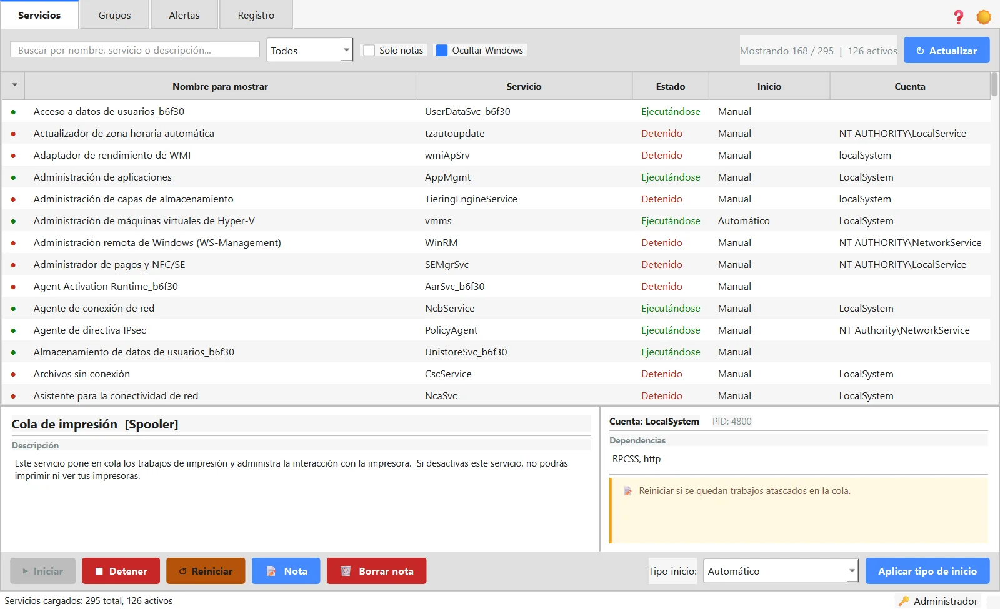
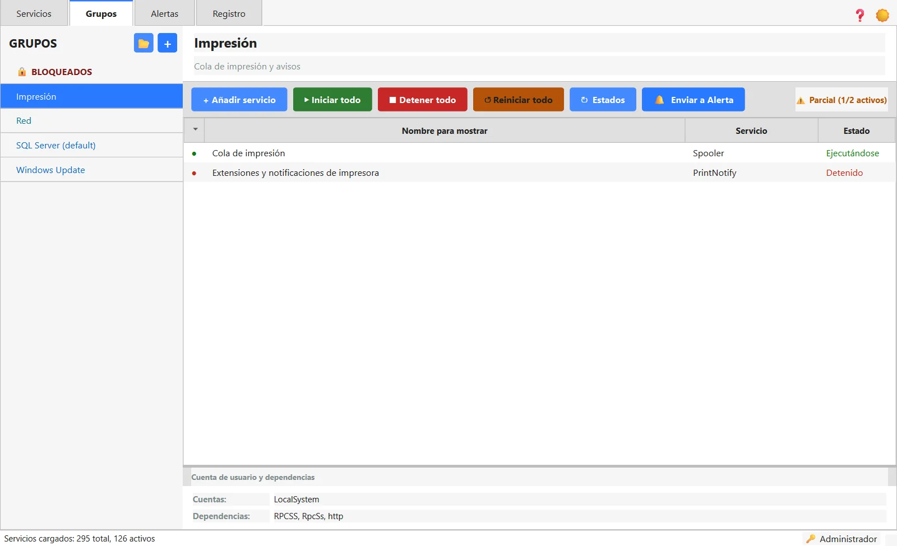
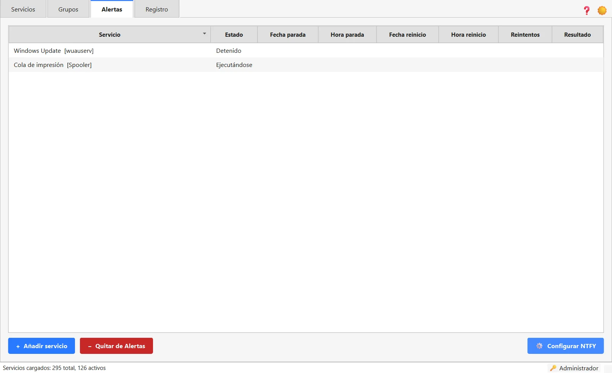
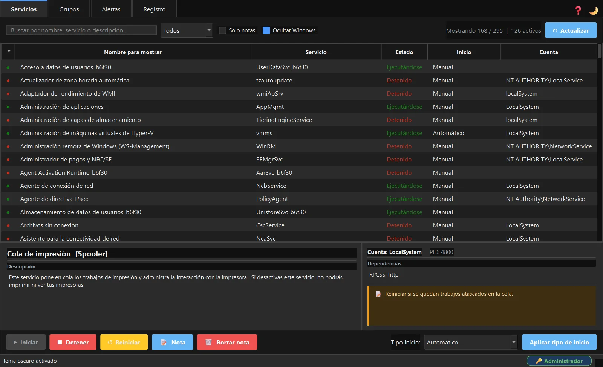

# MAServ

Gestiona y vigila los servicios de Windows desde una interfaz sencilla: inicia, detén, reinicia o cambia el tipo de inicio de cualquier servicio, organízalos en grupos por aplicación y lleva un registro de todas las acciones.

**Software gratuito desarrollado por [Masoft.es](https://masoft.es)**

[](https://github.com/MaSoft/MAServ/releases/latest)

También puedes descargarlo desde [masoft.es](https://masoft.es/descargas.html).



## Características
- Iniciar, detener, reiniciar y cambiar el tipo de inicio de cualquier servicio.
- Grupos por aplicación: arranca o para todos sus servicios a la vez; impórtalos y expórtalos en CSV.
- Monitorización automática cada 10 segundos, con aviso si algo cambia.
- Alertas con auto-reinicio: si un servicio crítico se cae, lo intenta arrancar y avisa por NTFY.
- Grupo BLOQUEADOS: impide de forma permanente que un servicio se ejecute, con vigilancia continua.
- Búsqueda por nombre, notas por servicio y servicios esenciales de Windows en rojo.
- Historial de acciones exportable a CSV, tema claro y oscuro y manual con F1.

## Capturas

| | |
|---|---|
| <br>**Grupos.** Los servicios de una aplicación juntos: iniciar, detener o reiniciar todos a la vez. | <br>**Alertas.** Servicios vigilados: si se caen, se arrancan solos y llega un aviso. |
| <br>**Tema oscuro.** Toda la aplicación en tema oscuro, diálogos incluidos. |  |

## Requisitos

| | |
|---|---|
| Sistema | Windows 10 o Windows 11 de 64 bits |
| Permisos | Administrador local, para operar servicios |
| Instalación | No hace falta: un solo .exe que se copia y se abre. Python va dentro |
| Espacio | 37 MB el programa; la base de datos y el registro se crean junto a él |
| Internet | No hace falta; solo para los avisos NTFY, si se activan |

Al abrirlo propone reiniciarse como administrador. El primer arranque tarda unos segundos.

## Descarga y comprobación

En [Releases](https://github.com/MaSoft/MAServ/releases/latest) están el programa (`MAServ_v1.2.1.exe`), su huella SHA-256 y el manual. Para comprobar que la descarga está completa, en PowerShell:

```powershell
Get-FileHash .\MAServ_v1.2.1.exe
```

Debe coincidir con `940efeb1125668d5469f8bc8216682cea03d718e5125dcb407297c1e88b2cf7f`.

## Manual

[manual_MAServ_portable.html](https://github.com/MaSoft/MAServ/releases/latest/download/manual_MAServ_portable.html): descárgalo y ábrelo en el navegador.

## Aviso legal

MAServ es gratuito y se entrega tal cual, sin garantía de ningún tipo. Al descargarlo y usarlo aceptas el aviso legal y las limitaciones de su manual.

> ⚠ Herramienta de uso interno para personal técnico. MAServ es una herramienta diseñada para técnicos y administradores de sistemas. El uso incorrecto puede provocar la detención de servicios críticos con consecuencias graves para la estabilidad del equipo o la continuidad del negocio.

**Limitaciones y exclusión de responsabilidad**
- Esta herramienta se proporciona tal cual, sin garantía de ningún tipo.
- El autor no se hace responsable de pérdidas de datos, interrupciones de servicio o daños derivados de un uso inadecuado.
- La identificación de servicios críticos del sistema operativo es orientativa y no sustituye el criterio del técnico responsable.
- Las plantillas de grupos incluidas son aproximaciones basadas en instalaciones típicas. Verifica siempre los nombres reales en services.msc antes de operar en entornos de producción.
- Uso restringido a personal autorizado. No redistribuir sin permiso del autor.

Este repositorio solo contiene el programa compilado y su documentación. © Masoft.es. Todos los derechos reservados.
